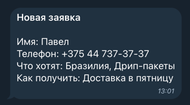
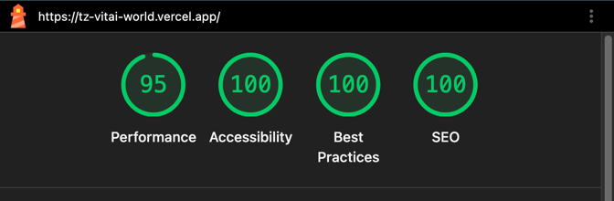

# Описание работы над проектом (написано без использования ИИ)

## Использемые инструменты и ресурсы

- Claude Code (подписка Max)
- Webstorm (ручные правки)
- Higgsfield
- Github
- Vercel (хостинг)
- Sketchfab
- Magnific

## Сообщение от TG-бота после успешного заполнения формы

## Скрин отчёта Lighthouse

## Этапы работы

1. Создание публичного репозитория. Инициализация проекта с последней версией Next JS.
2. Написание CLAUDE.md вручную.
3. Поиск референсов (Instagram, [Awwwards](https://www.awwwards.com/)) с учётом требований ТЗ.
4. Создание дизайн системы на основе референсов (при помощи Claude Artifacts).
5. Генерация нескольких вариантов макета (design skill) на основе дизайн-системы и референсов готовых сайтов (с указанием того, какие идеи и откуда заимствовать). Ручные правки макета и правки на основании комментариев. 
6. Добавлены 3d-модели. Сами модели .glb взяты со sketchfab, паттерны и графика - magnific.
7. Все фото сгенерированы с помощью higgsfield c промтом явно указывающим стилистику.
8. В процессе я понял, что изначальная тема меня не устраивает (хотя с ней было всё ок), поэтому было внесено много точечных правок по дизайну.
9. Для обработки данных формы используются Next server actions. На vercel серверные функции выполняются в изолированной среде без доступа к файловой системе. Поэтому заяки не пишуться ни в какой файл. Для прода можно использовать vercel/blob. Хотя, с учётом специфики сайта (для реализации товаров внутри РБ), нельзя для прода использовать vercel. Скорее всего это будет просто легкий VPS где-нибудь на hoster.by, на котором мы поднимем докер, предварительно завернув next в контейнер. Там можно уже настроить запись в файл. Но удобнее получать уведомления в ТГ. При получение данных формы, server action шлёт уведомление в ТГ. Чтобы это работало, указываем bot token id и chat id в переменных окружения при деплое.
10. Для отслежживания источников заявок, на все рекламные ссылки навешиваем utm-метки. Они будут прочитаны, сохранены в session storage и отправлены вместе с другими данными формы.

### Сессии

Экспортированные сессии находяться в `./sessions_transcript`
В виду того, что проект совсем маленький и контекст сессии расходовался медленно, задачи выполнялись последовательно в рамках одной сессии, до тех пор, пока контекст не заполнялся на 50%.

### Промт для генерации дизайн-системы (не попал в экспорт)

Нужно создать дизайн систему для лендинга небольшой обжарки кофе. Это маленькая мастерская: обжаривают партиями по 5 кг с 2019 года. Целевая аудитория: люди 25–45 лет, пьют кофе дома или в офисе, большинство заходит с телефона по рекламе в Instagram и Яндексе. Тон: тёплый и простой, без пафоса и без «премиального» глянца.

Нужно чтобы цвета были мягкими и не слишком яркими. Основые фоновые цвета теплые и светлые. Акцентные цвета - могут быть ярче (это может быть коралловый, терракот, электрик). Вспомогательные цвета котнтрастные, но не слишком тёмные.  Используй предоставленные изображения для примера.

Несколько шрифтов. Не слишком строгие, но хорошо читаемые. Один из шрифтов может быть "несерьёзным" - например рукописным. Он подойдёт для подписей к изображениям.

Токены отступов не должны быть малыми. Сайт одностраничный и не содержит большого количества информации. Поэтому "воздушность" приветствуется.

Теней либо мало, либо нет совсем.

Скругления допустимы, но небольшие, до 5px